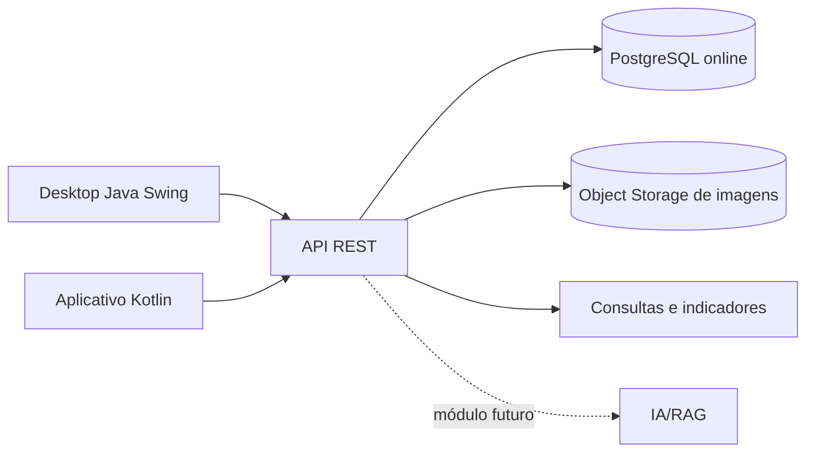

# SIAM — Sistema Inteligente de Auditoria Metrológica

> Plataforma acadêmica para apoiar fiscalizações metrológicas, com rastreabilidade, evidências fotográficas e análise de dados.

## Visão do projeto

O SIAM mantém a aplicação desktop Java/Swing já desenvolvida e evolui para uma arquitetura multiplataforma. O núcleo do sistema registra usuários, postos, bombas, fiscalizações, irregularidades e evidências. Uma API REST deverá permitir o compartilhamento seguro desses dados com um aplicativo mobile em Kotlin.

O projeto é acadêmico e inspirado em atividades de fiscalização de bombas medidoras de combustíveis. As integrações com IA, normas oficiais e serviços externos serão implementadas somente após validação dos requisitos, da segurança e das políticas de uso.

## Objetivos

- Digitalizar o registro e o acompanhamento das fiscalizações.
- Preservar histórico, autoria e evidências de cada inspeção.
- Apoiar decisões com indicadores e análise de reincidência.
- Permitir trabalho conectado pelo desktop e, futuramente, pelo mobile.
- Criar uma base técnica para integrações com IA e normas metrológicas.

## Escopo atual e evolução

### Já disponível no MVP

- Autenticação por e-mail ou matrícula.
- Perfis ADMIN e FISCAL.
- CRUD de usuários, postos, bombas e fiscalizações.
- Dashboard operacional, filtros e controle de permissões.
- Arquitetura MVC, DAO, Service, JDBC e Maven.

### Próximas entregas

- API REST centralizada.
- Banco de dados online com acesso controlado.
- Upload de imagens para armazenamento de objetos, mantendo apenas metadados e URL no banco.
- Evidências vinculadas às fiscalizações, com descrição, autoria e data.
- Dashboard analítico e exportação de relatórios.
- Aplicativo Android em Kotlin.
- IA/RAG como módulo experimental e auditável.

## Requisitos e documentação

| Documento | Conteúdo |
|---|---|
| [Levantamento de requisitos](docs/requisitos.md) | Requisitos funcionais, não funcionais, regras, escopo e critérios de aceite |
| [Casos de uso](docs/casos-de-uso.md) | Atores, diagramas e fluxos principais |
| [Análise de dados](docs/analise-de-dados.md) | Entidades, indicadores, qualidade e privacidade |
| [Arquitetura e roadmap](docs/arquitetura-roadmap.md) | Desktop, API, banco online, storage e mobile |
| [Sprint 1](docs/sprint-1-foundation.md) | Registro da fundação já implementada |
| [Proposta acadêmica](PROPOSTA.md) | Contexto, objetivos, metodologia e entregáveis |
| [Guia do time](INSTRUCOES.md) | Fluxo de desenvolvimento e colaboração |

## Arquitetura proposta



O MySQL/JDBC permanece documentado como a base do MVP. Para a evolução online, a recomendação é PostgreSQL gerenciado com camada gratuita e storage compatível, como Supabase ou serviço equivalente. A escolha definitiva deve considerar limites, autenticação, backup, região e termos do provedor; nenhuma credencial deve ser versionada.

## Tecnologias

| Camada | MVP | Evolução |
|---|---|---|
| Desktop | Java 21, Swing | Cliente consumidor da API |
| Mobile | — | Kotlin, Android e Jetpack Compose |
| API | — | REST, autenticação e validação |
| Dados | MySQL, JDBC | PostgreSQL gerenciado |
| Imagens | Planejado | Object Storage via API |
| Build | Maven | Gradle no aplicativo Kotlin |
| IA | Planejada | Gemini/RAG, com revisão humana |

## Execução do MVP

Pré-requisitos: Java 21, Maven e MySQL 8+.

```bash
mvn clean install
```

Configure as credenciais por variáveis de ambiente ou arquivo local não versionado. O banco deve ser inicializado conforme o script de criação disponível no projeto/ambiente de desenvolvimento.

## ODS e equipe

O SIAM contribui para os ODS 9, 12 e 16 ao modernizar processos de fiscalização, apoiar consumo responsável e fortalecer instituições eficazes.

Equipe: Danilo Costa Bento, Letícia de Lima Silva, Leonardo Lopes Correia, José Victor Contierro e Renan dos Santos Souza.

Disciplina: Programação de Soluções Computacionais — Universidade São Judas Tadeu — 2026/1.

## Status

O MVP desktop está em evolução. A API, o banco online, o armazenamento de imagens e o aplicativo Kotlin são escopo de expansão; seus requisitos e critérios estão descritos nos documentos vinculados acima.

Projeto acadêmico para fins educacionais e de pesquisa.
