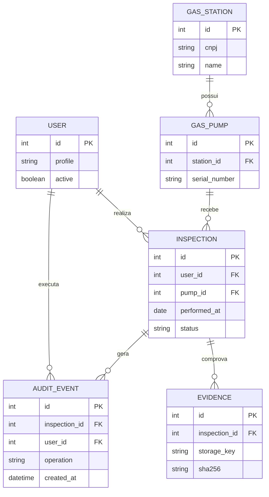

# Análise de dados

## 1. Dados e finalidade

| Domínio | Dados principais | Uso |
|---|---|---|
| Usuário | perfil, matrícula, estado | autenticação e autorização |
| Posto | CNPJ, razão social, endereço, estado | localização da fiscalização |
| Bomba | posto, série, modelo, estado | identificação do equipamento |
| Fiscalização | responsável, data, medição, irregularidade, status | registro operacional |
| Evidência | storage key, hash, MIME, tamanho, descrição, autor | comprovação e auditoria |
| Histórico | entidade, operação, autor, data, antes/depois | rastreabilidade |

## 2. Modelo conceitual

## 3. Indicadores

- fiscalizações por período, posto e fiscal;
- distribuição por status e irregularidade;
- reincidência por CNPJ, considerando intervalo configurável;
- tempo médio entre registro e conclusão;
- quantidade e tamanho médio de evidências;
- registros sem evidência ou com dados pendentes.

Cada indicador deve ser calculado por consulta parametrizada, exibir a data de atualização e permitir rastrear os registros que o compõem.

## 4. Qualidade, segurança e privacidade

- validar CNPJ, datas, enumerações e unidades de medida;
- impedir duplicidade de login, matrícula, série e CNPJ quando aplicável;
- usar UTC no armazenamento e converter para a interface;
- guardar imagens fora do banco, com URL temporária ou referência protegida;
- aplicar retenção e remoção conforme orientação institucional;
- usar dados anonimizados em demonstrações e testes;
- não enviar dados pessoais ou imagens para IA sem autorização e necessidade comprovada.

## 5. Estratégia de migração

O MySQL do MVP não será substituído de forma abrupta. Primeiro serão definidos contratos e migrations; depois, carga de dados de teste, validação de contagens e amostragem de vínculos; por fim, uma janela de migração e plano de retorno. O aplicativo desktop poderá consumir a API antes da retirada gradual do acesso JDBC.
