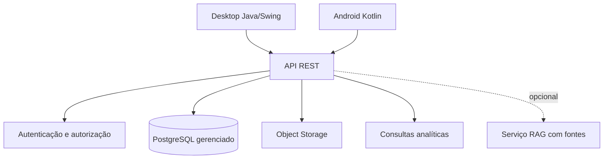

# Arquitetura e roadmap de evolução

## 1. Arquitetura alvo

O desktop existente continua sendo a referência funcional do MVP. A API passa a concentrar regras, autenticação e acesso ao banco. O aplicativo Kotlin será um cliente da API, não um segundo banco.

## 2. Banco e imagens online

Para o protótipo acadêmico, deve ser avaliado um provedor com camada gratuita, PostgreSQL gerenciado, autenticação e object storage (por exemplo, Supabase ou equivalente). A escolha precisa ser registrada após comparar limites de armazenamento, tráfego, backup, região, políticas de privacidade e facilidade de exportação.

O banco armazena `storage_key`, hash, MIME, tamanho e metadados. O binário fica no storage e é acessado por URL assinada ou endpoint protegido. Não serão usados links públicos permanentes para evidências reais.

## 3. Segurança mínima

- tokens com expiração e renovação controlada;
- autorização por perfil e propriedade do registro;
- TLS em produção;
- limites de payload e upload;
- validação de conteúdo e antivírus quando disponível;
- logs sem senha, token ou imagem;
- backups e procedimento de restauração documentados.

## 4. Roadmap

| Fase | Entrega | Resultado |
|---|---|---|
| 1 | Requisitos e modelos | documentação aprovada e casos de uso |
| 2 | API de leitura | contratos e autenticação básicos |
| 3 | API transacional | usuários, postos, bombas e fiscalizações |
| 4 | Evidências | upload, storage, metadados e histórico |
| 5 | Analytics | indicadores, filtros e relatórios |
| 6 | Mobile | login, consulta, registro e upload em Kotlin |
| 7 | IA/RAG | prova de conceito com fonte e revisão humana |

## 5. Decisões pendentes

- provedor definitivo do banco e storage;
- framework da API;
- estratégia de sincronização e eventual modo offline;
- política institucional de retenção de imagens;
- conjunto de normas autorizado para o módulo RAG.
