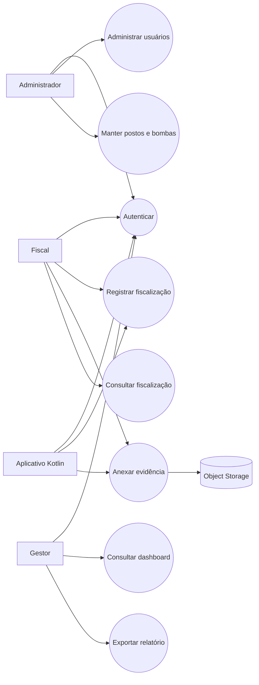

# Diagramas e especificação de casos de uso

## 1. Atores

- **Administrador:** configura usuários e dados mestres.
- **Fiscal:** registra e acompanha inspeções.
- **Gestor:** consulta indicadores e relatórios.
- **Serviço de armazenamento:** recebe e entrega imagens por API.
- **Aplicativo Kotlin:** cliente mobile autenticado da API.

## 2. Diagrama geral

## 3. Caso de uso: registrar fiscalização

**Ator principal:** Fiscal.  
**Pré-condições:** sessão válida; posto e bomba ativos.  
**Fluxo principal:** selecionar posto e bomba; informar data, medição, irregularidade e observações; validar dados; salvar; registrar autoria; exibir confirmação.  
**Exceções:** dados incompletos, bomba inativa ou sessão expirada impedem o salvamento e apresentam mensagem acionável.  
**Pós-condições:** fiscalização persistida com status inicial e disponível para consulta.

## 4. Caso de uso: anexar evidência

**Ator principal:** Fiscal.  
**Pré-condições:** fiscalização existente e autorização válida.  
**Fluxo principal:** selecionar imagem; validar extensão, MIME e tamanho; enviar à API; obter referência do storage; salvar metadados e vínculo; confirmar upload.  
**Exceções:** arquivo inválido, excedente, indisponibilidade do storage ou falha de autorização não devem gerar vínculo incompleto.  
**Pós-condições:** evidência consultável com descrição, hash, autor e data.

## 5. Caso de uso: analisar dashboard

**Ator principal:** Gestor.  
**Fluxo principal:** escolher período e filtros; API agrega dados; sistema exibe volume, status, irregularidades e reincidência; usuário pode abrir os registros de origem.  
**Regra:** todo indicador deve informar período, filtros e quantidade de registros considerados.
